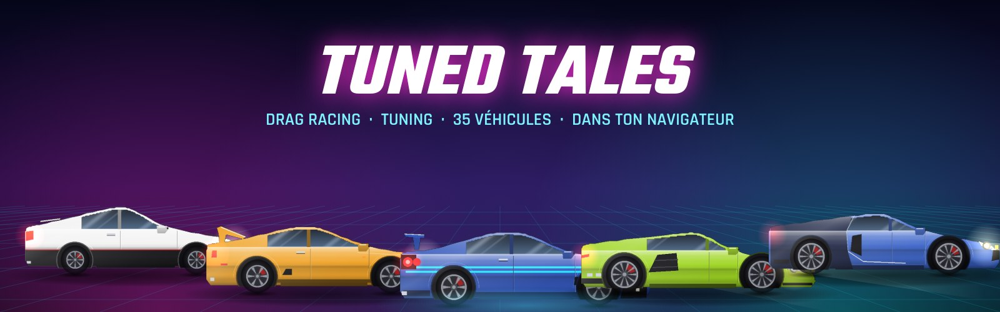
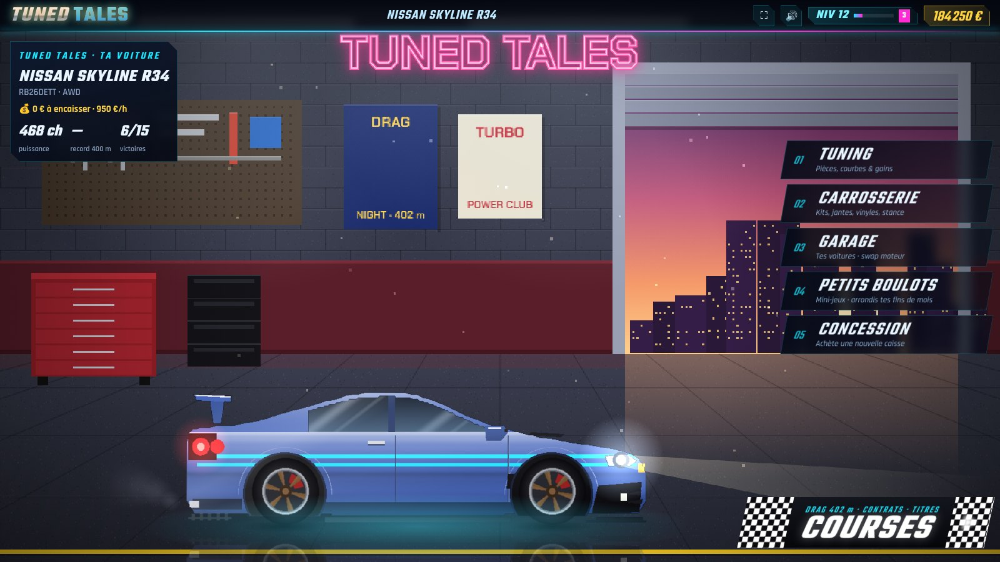
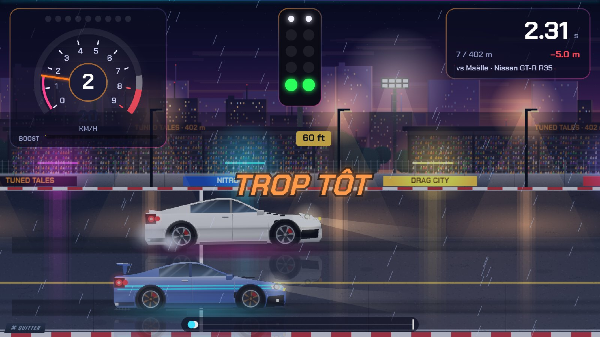
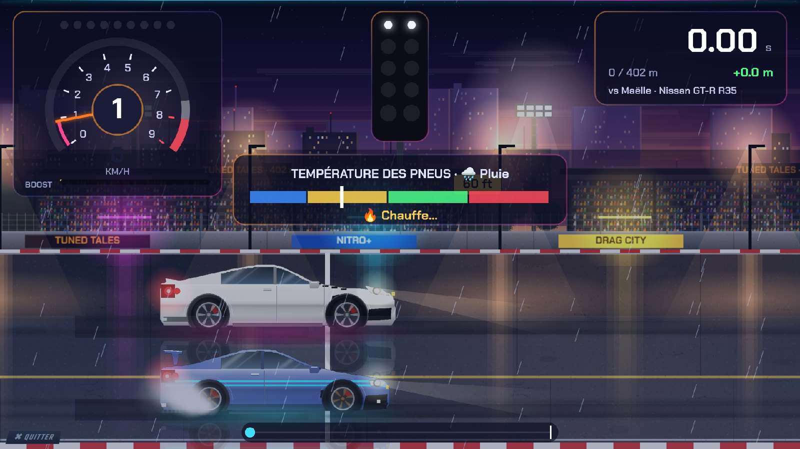
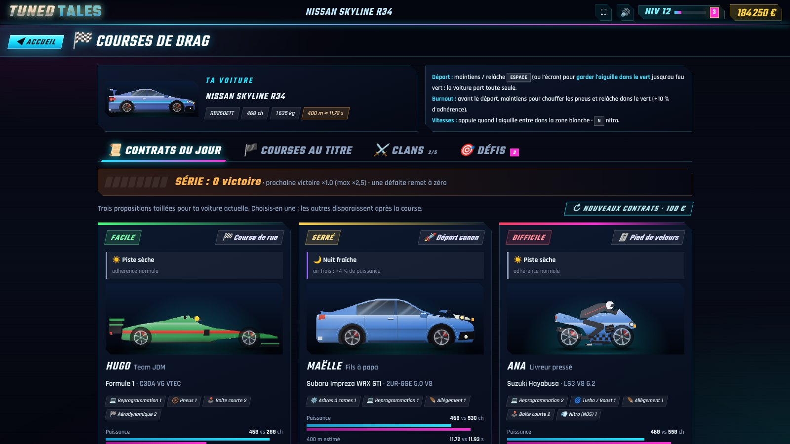
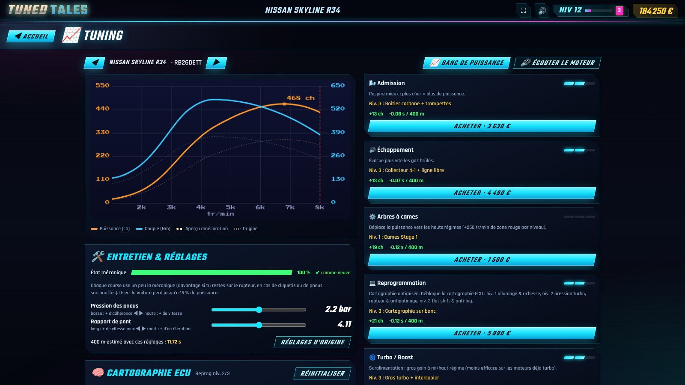
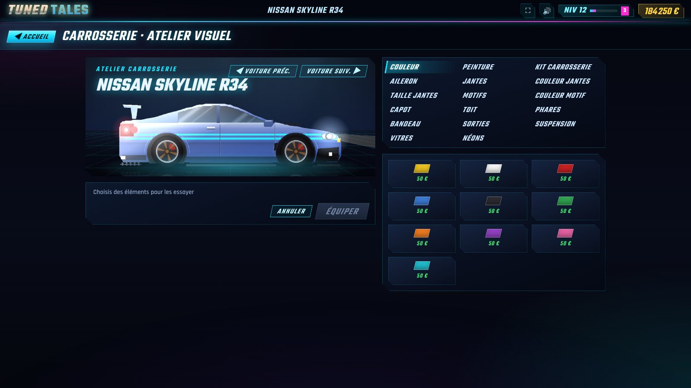
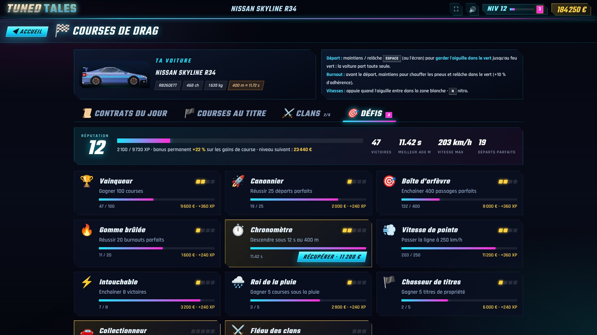
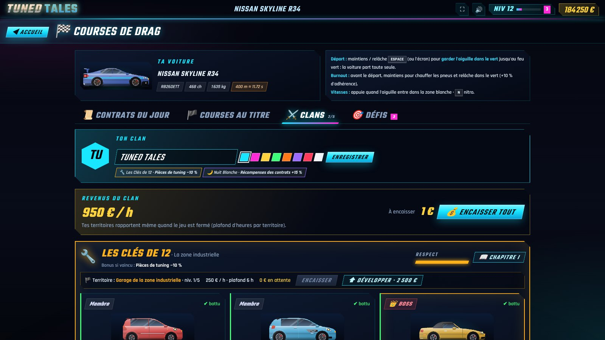
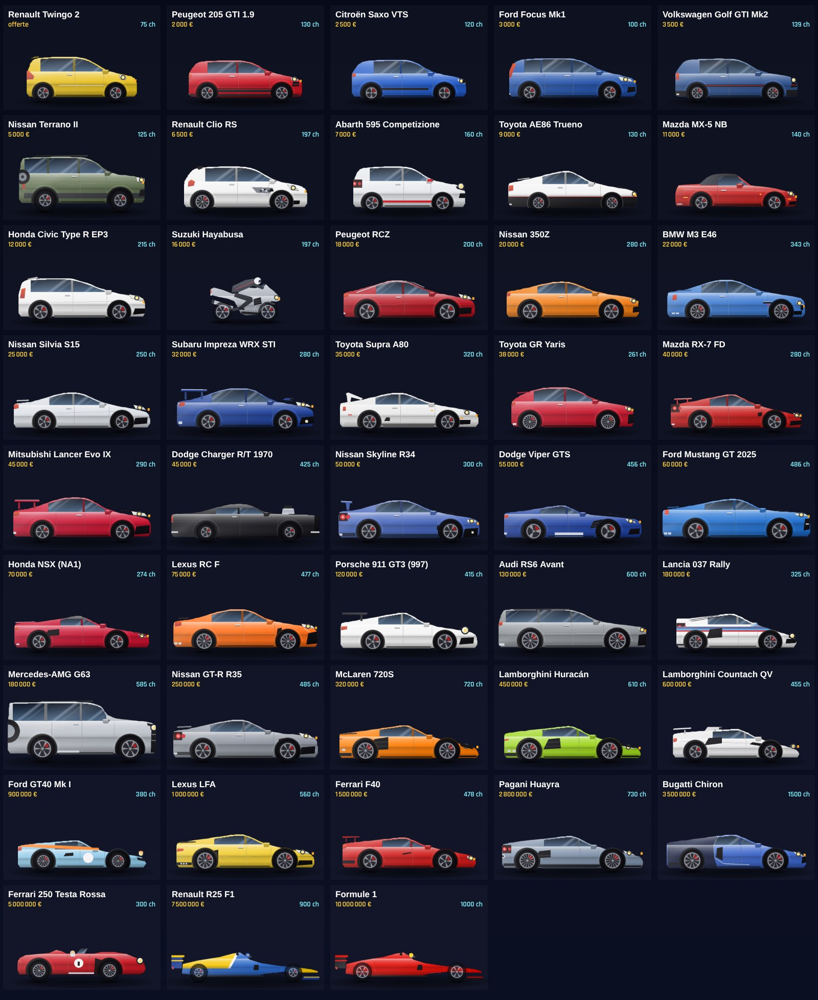

<div align="center">



### Drag racing & tuning semi-réaliste, directement dans ton navigateur

[](https://firetaleshy.github.io/TunedTales/)

[](CHANGELOG.md)
[](#-le-garage)
[](#-tuning-swap--ecu)
[](#-progression)
[](#%EF%B8%8F-sous-le-capot)
[](#-commandes)

**Commence en Twingo 2 avec 600 €. Finis en Bugatti Chiron, en Renault R25 championne du monde… ou en Formule 1 à dix millions.**

[Jouer](https://firetaleshy.github.io/TunedTales/) · [Nouveautés](CHANGELOG.md) · [Signaler un bug](../../issues/new?template=bug.md) · [Proposer une idée](../../issues/new?template=idee.md)

</div>

---

## 📖 Sommaire

- [Le concept](#-le-concept)
- [Aperçu](#-aperçu)
- [Comment jouer](#-comment-jouer)
- [Les courses](#-les-courses)
- [Le garage](#-le-garage)
- [Tuning, swap & ECU](#-tuning-swap--ecu)
- [Carrosserie](#-carrosserie)
- [La ville : clans & territoires](#-la-ville--clans--territoires)
- [Progression](#-progression)
- [Sous le capot](#%EF%B8%8F-sous-le-capot)
- [Nouveautés & crédits](#-nouveautés)

---

## ⚡ Le concept

Tu débarques dans la ville avec une **Twingo 2 de 75 ch**. Pour monter en gamme, il faut gagner des **courses de drag sur 402 m** : réussir son burnout, tenir le régime au feu, passer les rapports au bon moment et balancer la nitro au bon endroit.

Chaque euro gagné repart dans ta caisse : pièces moteur, turbo, **swap de moteur**, **cartographie ECU**, réglages de châssis, kit widebody, jantes, néons… jusqu'à t'offrir les légendes du garage et faire tomber les **cinq clans** qui tiennent la ville.

> 🎮 **Aucune installation, aucun compte.** Le jeu tourne dans le navigateur, sur PC comme sur mobile, et sauvegarde automatiquement ta partie.

## 📸 Aperçu

<table>
<tr>
<td width="50%"></td>
<td width="50%"></td>
</tr>
<tr>
<td align="center"><b>🏠 Le garage</b><br>Ta voiture, tes stats, l'accès à tout le jeu.</td>
<td align="center"><b>🌧️ Course de nuit sous la pluie</b><br>Néons, lampadaires et bitume mouillé.</td>
</tr>
<tr>
<td width="50%"></td>
<td width="50%"></td>
</tr>
<tr>
<td align="center"><b>🔥 Burnout de chauffe</b><br>Relâche dans le vert pour +10 % d'adhérence.</td>
<td align="center"><b>📜 Contrats</b><br>Trois rivaux taillés pour ta voiture, avec la météo.</td>
</tr>
<tr>
<td width="50%"></td>
<td width="50%"></td>
</tr>
<tr>
<td align="center"><b>📈 Tuning</b><br>Courbes, gains estimés, entretien, réglages et ECU.</td>
<td align="center"><b>🎨 Carrosserie</b><br>Kits, jantes, vinyles, stance, néons, aperçu en direct.</td>
</tr>
<tr>
<td width="50%"></td>
<td width="50%"></td>
</tr>
<tr>
<td align="center"><b>🎯 Réputation & défis</b><br>Niveaux, primes, bonus permanents, 11 défis à paliers.</td>
<td align="center"><b>⚔️ Clans</b><br>Cinq boss, du lore à chaque victoire, des territoires à encaisser.</td>
</tr>
</table>

## 🎮 Comment jouer

### Commandes

| Action | Clavier | Tactile |
|---|---|---|
| Burnout (avant le départ) | maintenir puis relâcher <kbd>Espace</kbd> | maintenir puis relâcher l'écran |
| Doser le régime au départ | maintenir / relâcher <kbd>Espace</kbd> | maintenir / relâcher l'écran |
| Passer la vitesse | <kbd>Espace</kbd> ou <kbd>↑</kbd> | toucher l'écran |
| Nitro | <kbd>N</kbd> | bouton **NITRO** |
| Plein écran | <kbd>F</kbd> | bouton ⛶ |

### 📱 Sur mobile

- Le jeu se joue **en paysage** : tenu en portrait, il s'affiche automatiquement à l'horizontale.
- **Installe-le comme une appli** pour un vrai plein écran : *Partager → Sur l'écran d'accueil* (iPhone) ou *⋮ → Installer l'application* (Android).
- Toute la zone de jeu réagit au toucher, avec **vibrations** au départ, aux passages et à la nitro.

### Déroulé d'une course

1. **🔥 Burnout** : maintiens pour faire fumer les pneus, relâche quand la jauge de température est **dans le vert** (+10 % d'adhérence). Trop froid : aucun gain. Trop chaud : ça glisse.
2. **🚦 Pré-stage** : garde l'aiguille du compte-tours **dans la zone verte** pendant tout le compte à rebours. Au feu vert, la voiture part toute seule.
3. **⚙️ Passages** : passe la vitesse quand l'aiguille entre dans la zone blanche. Parfait = turbo qui retombe moins, gain de temps.
4. **💨 Nitro** : un coup de boost à placer au bon moment.
5. **🧾 Ticket de chrono** : réaction, 60 ft, 330 ft, 1/8 mile, 1000 ft, E.T. et vitesse finale, comme sur un vrai dragstrip.

## 🏁 Les courses

| Mode | Principe |
|---|---|
| 📜 **Contrats du jour** | Trois rivaux générés selon ta voiture (facile, serré, difficile), avec six types : course de rue, pari, pied de velours, départ canon, boîte parfaite… |
| 🏴 **Courses au titre** | Le gagnant repart avec la voiture de l'autre. Gagne une caisse… ou perds la tienne. |
| ⚔️ **Clans** | Quinze légendes de la ville réparties en cinq clans, chacun mené par un boss. |
| 🔥 **Séries** | Chaque victoire d'affilée multiplie tes gains, jusqu'à **×2,5**. |

### 🌦️ Conditions de piste

| Condition | Effet | Gains |
|---|---|---|
| ☀️ Piste sèche | adhérence normale | — |
| 🌙 Nuit fraîche | air frais : **+4 % de puissance** | — |
| 🧪 Piste préparée | **+12 % d'adhérence** | — |
| 🔥 Bitume brûlant | −7 % d'adhérence, −4 % de puissance | **+15 %** |
| 🌧️ Pluie | **−30 % d'adhérence** : dose ton départ ! | **+40 %** |

## 🚗 Le garage

<div align="center"></div>

Chaque véhicule est construit à partir de ses **vraies cotes** (longueur, hauteur, empattement, porte-à-faux, garde au sol, ligne de caisse) et roule sur des **roues à sa taille réelle**.

<details>
<summary><b>📋 Liste complète des 35 véhicules (cliquer pour déplier)</b></summary>

| Véhicule | Moteur d'origine | Transmission | Prix |
|---|---|:---:|---:|
| Renault Twingo 2 | D4F 1.2 · 75 ch | traction | *offerte* |
| Peugeot 205 GTI 1.9 | XU9JA 1.9 · 130 ch | traction | 2 000 € |
| Ford Focus Mk1 | Zetec 1.6 · 100 ch | traction | 3 000 € |
| Volkswagen Golf GTI Mk2 | KR 1.8 16v · 139 ch | traction | 3 500 € |
| Nissan Terrano II | TD27 turbo diesel · 125 ch | 4x4 | 5 000 € |
| Renault Clio RS | F4R 2.0 · 197 ch | traction | 6 500 € |
| Toyota AE86 Trueno | 4A-GE 1.6 16v · 130 ch | propulsion | 9 000 € |
| Mazda MX-5 NB | BP 1.8 · 140 ch | propulsion | 11 000 € |
| Honda Civic Type R EP3 | K20A VTEC · 215 ch | traction | 12 000 € |
| 🏍️ Suzuki Hayabusa | 1340 4 cyl. · 197 ch | propulsion | 16 000 € |
| Peugeot RCZ | 1.6 THP · 200 ch | traction | 18 000 € |
| BMW M3 E46 | S54 · 343 ch | propulsion | 22 000 € |
| Nissan Silvia S15 | SR20DET · 250 ch | propulsion | 25 000 € |
| Subaru Impreza WRX STI | EJ257 boxer turbo · 280 ch | 4x4 | 32 000 € |
| Toyota Supra A80 | 2JZ-GTE · 320 ch | propulsion | 35 000 € |
| Mazda RX-7 FD | 13B-REW rotatif · 280 ch | propulsion | 40 000 € |
| Mitsubishi Lancer Evo IX | 4G63T · 290 ch | 4x4 | 45 000 € |
| Dodge Charger R/T 1970 | 426 Hemi V8 · 425 ch | propulsion | 45 000 € |
| Nissan Skyline R34 | RB26DETT · 300 ch | 4x4 | 50 000 € |
| Dodge Viper GTS | 8.0 V10 · 456 ch | propulsion | 55 000 € |
| Ford Mustang GT 2025 | Coyote 5.0 V8 · 486 ch | propulsion | 60 000 € |
| Honda NSX (NA1) | C30A V6 VTEC · 274 ch | propulsion | 70 000 € |
| Lexus RC F | 2UR-GSE 5.0 V8 · 477 ch | propulsion | 75 000 € |
| Porsche 911 GT3 (997) | Mezger 3.6 · 415 ch | propulsion | 120 000 € |
| Lancia 037 Rally | 2.0 compresseur · 325 ch | propulsion | 180 000 € |
| Nissan GT-R R35 | VR38DETT · 485 ch | 4x4 | 250 000 € |
| McLaren 720S | M840T V8 biturbo · 720 ch | propulsion | 320 000 € |
| Lamborghini Huracán | V10 5.2 · 610 ch | 4x4 | 450 000 € |
| Lamborghini Countach QV | V12 5.2 · 455 ch | propulsion | 600 000 € |
| Lexus LFA | 1LR-GUE V10 · 560 ch | propulsion | 1 000 000 € |
| Pagani Huayra | AMG 6.0 V12 biturbo · 730 ch | propulsion | 2 800 000 € |
| Bugatti Chiron | W16 8.0 quadriturbo · 1 500 ch | 4x4 | 3 500 000 € |
| Ferrari 250 Testa Rossa | Colombo V12 · 300 ch | propulsion | 5 000 000 € |
| 🔒 Renault R25 F1 *(livrée officielle verrouillée)* | RS25 3.0 V10 · 900 ch | propulsion | 7 500 000 € |
| 👑 **Formule 1** | **V6 turbo hybride · 1 000 ch** | propulsion | **10 000 000 €** |

</details>

## 🔧 Tuning, swap & ECU

- **11 catégories de pièces** : admission, échappement, arbres à cames, reprogrammation, turbo, allègement, pneus, boîte courte, embrayage, aéro, nitro. Chaque pièce affiche son **gain estimé** (ch et secondes au 400 m) avant achat.
- **Courbes de puissance et de couple** en direct, et un **banc de puissance** animé avec la voiture sur les rouleaux.
- **Swap moteur** : 38 moteurs, tous montables dans toutes les voitures. Oui, une Twingo en W16, c'est possible.
- **Cartographie ECU** : avance à l'allumage, richesse, pression de turbo, rupteur, couple en 1re, flat shift, anti-lag. Plus tu pousses, plus le **cliquetis** te guette (−18 % de puissance en pleine course).
- **Entretien** : chaque course use un peu la mécanique (davantage sur le rupteur, au cliquetis ou avec des pneus surchauffés). Usée, la voiture perd jusqu'à 15 % de puissance ; **réparation en un clic**.
- **Réglages de châssis** : pression des pneus (adhérence contre vitesse) et rapport de pont (accélération contre vitesse max), avec le 400 m estimé recalculé en direct.

## 🎨 Carrosserie

Peinture (brillante, mate, nacrée, métallisée), **kits carrosserie jusqu'au widebody**, ailerons, jantes (modèles, couleurs, tailles), vinyles (bandes, damier, flammes, tribal, numéro de course), hauteur de caisse, teinte des vitres, **néons**, capot carbone ou ajouré, écope de toit, bandeau de pare-soleil, phares xénon / fumés / angel eyes, sorties d'échappement. Tout s'essaie en **aperçu en direct** avant d'acheter.

## 🏙️ La ville : clans & territoires

Cinq clans se partagent la ville. Bats leurs membres puis leur **boss** : il rejoint ton crew, t'offre un **bonus permanent** (pièces moins chères, contrats mieux payés, séries plus longues…) et te débloque un **chapitre de lore**. Chaque clan tombé te donne un **territoire** qui rapporte des **revenus passifs**, même jeu fermé, et que tu peux améliorer.

## 📈 Progression

- **⭐ Réputation** : chaque course rapporte de l'XP (victoire, départ parfait, passages parfaits, burnout réussi). Chaque niveau donne une **prime en cash** et **+2 % de gains** permanents, jusqu'à +50 %.
- **🎯 11 défis à paliers** : victoires, départs parfaits, passages parfaits, burnouts, chrono sous 9 s, 300 km/h, séries, pluie, titres de propriété, collection, boss de clan.
- **💼 Petits boulots** : livraison de pizzas, station de lavage, serrage au couple. Des mini-jeux pour arrondir les fins de mois.
- **🎁 Bonus quotidien** qui grimpe sur 7 jours consécutifs.

## 🛠️ Sous le capot

| | |
|---|---|
| **Stack** | 100 % HTML / CSS / JavaScript, aucune dépendance, aucun build. Servi tel quel par GitHub Pages. |
| **Rendu** | Canvas 2D en 1920×1080. Les véhicules sont **dessinés par le code** (aucune image) à partir d'un **modèle paramétrique** : cotes réelles, points de style, lignes lissées, peinture avec reflet d'horizon et vernis, rastérisation fine puis anticrénelage. |
| **Physique** | Courbes de couple par moteur, rapports de boîte, adhérence et transfert de charge simplifié, traînée aérodynamique, résistance au roulement, temps de réponse du turbo, simulation à 120 Hz. |
| **Son** | Moteurs **simulés physiquement** (cylindres, soupapes, guides d'ondes admission / échappement) via AudioWorklet, plus turbo, dump valve, pétarades et vent. Un synthé de secours prend le relais hors `https` / `localhost`. |
| **Sauvegarde** | `localStorage` du navigateur, automatique. |

### Structure du projet

```
index.html              page unique du jeu
style.css               interface (thème néon / underground)
js/data.js              voitures, moteurs, pièces, adversaires, clans, lore
js/physics.js           courbes moteur, fiche technique, simulation de drag
js/sprites.js           modèle paramétrique et rendu des véhicules
js/audio.js             sons moteurs simulés
js/game.js              économie, contrats, réputation, défis, sauvegarde
js/race.js              course, HUD, décor de nuit
js/jobs.js              mini-jeux des petits boulots
js/fx.js                pièces, confettis, étincelles, reflets
js/ui.js · js/main.js   menus, écrans, boucle principale, entrées
docs/                   captures, bannière, messages Discord
```

### Lancer en local

```bash
python3 -m http.server 8000
```

Puis ouvre `http://localhost:8000`. Ouvrir directement `index.html` marche aussi, mais avec le son de secours.

## 📜 Nouveautés

Toutes les versions sont détaillées dans le **[CHANGELOG](CHANGELOG.md)**. Dernière version : **v1.18.0 « Dans la poche »** : paysage forcé sur mobile, jeu installable comme une appli, vibrations, commandes tactiles plein écran.

## 🙏 Crédits

- Synthèse du son moteur : [engine-sound-generator](https://github.com/Antonio-R1/engine-sound-generator) d'Antonio-R1 (licence MIT, voir `js/vendor/LICENSE-engine-sound-generator.txt`), d'après Baldan et al. 2015, *Physically informed car engine sound synthesis*.
- Silhouettes et cotes relevées sur des photos de profil et des fiches techniques constructeurs.
- Polices : Teko, Rajdhani, Chakra Petch, Press Start 2P (Google Fonts).
- Les noms et modèles de véhicules appartiennent à leurs constructeurs respectifs ; ce projet est un jeu de fan non officiel.

<div align="center">

---

**[▶ JOUER MAINTENANT](https://firetaleshy.github.io/TunedTales/)**

*Fait avec ❤️ et beaucoup de gomme brûlée.*

</div>
