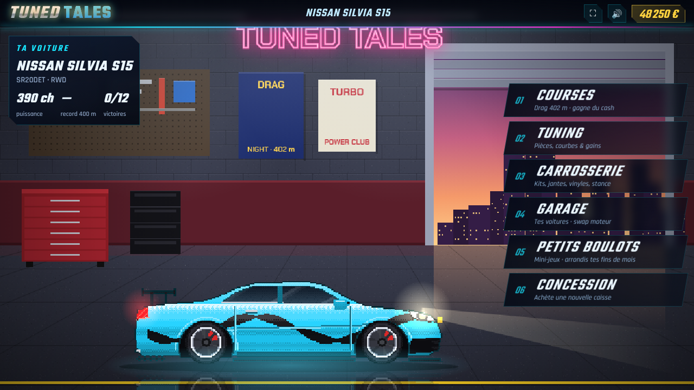
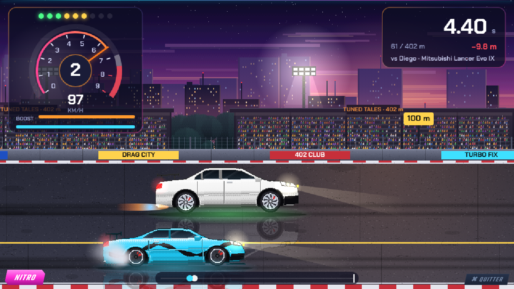
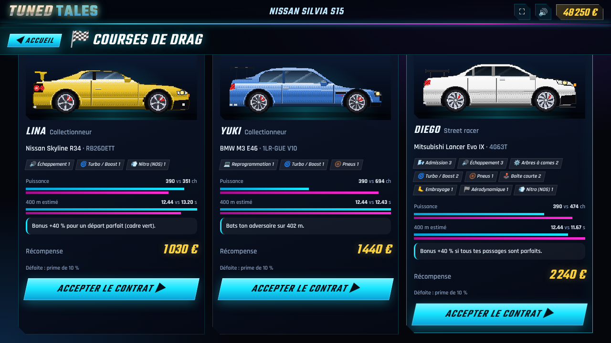
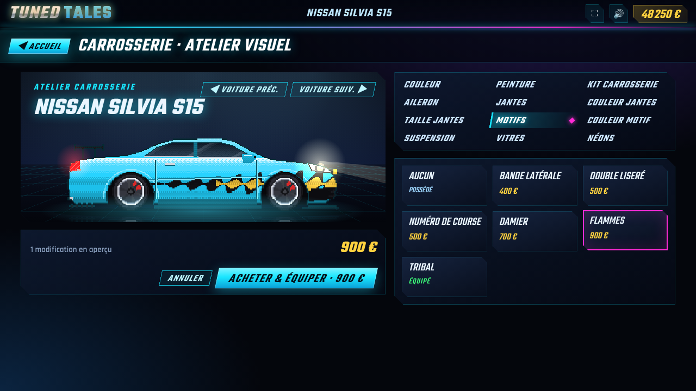
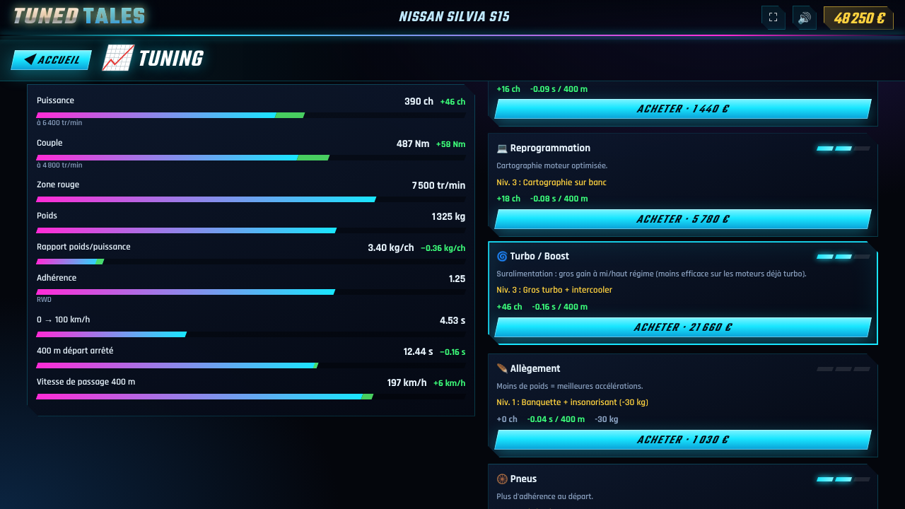
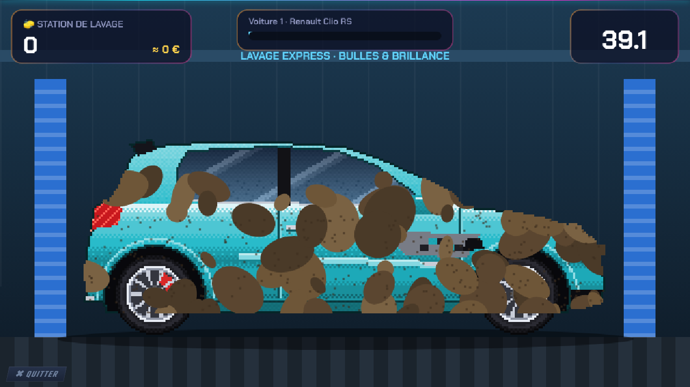

# 🏁 TUNED TALES

### Drag racing & tuning en pixel art 2.5D — directement dans ton navigateur

*Commence en Twingo 2. Finis en Formule 1 à dix millions.*

---

## ⚡ Le concept

Tu débarques avec une **Twingo 2 de 75 ch** et 600 € en poche. Enchaîne les **courses de drag sur 402 m**, remplis des **contrats**, fais des **petits boulots**, puis réinvestis tout dans ta caisse : pièces moteur, turbo, swap de moteur, kit widebody, jantes, vinyles, néons… jusqu'à t'offrir les monstres du garage.

<table>
<tr>
<td width="50%"></td>
<td width="50%"></td>
</tr>
<tr>
<td align="center"><b>🏁 Drag 402 m</b> Tiens l'aiguille dans le vert, passe les vitesses au bon moment, balance la nitro.</td>
<td align="center"><b>📜 Contrats</b> 3 propositions à chaque fois, adaptées à ta voiture : pari, défi, bonus…</td>
</tr>
<tr>
<td width="50%"></td>
<td width="50%"></td>
</tr>
<tr>
<td align="center"><b>🎨 Carrosserie</b> Kits, ailerons, jantes, vinyles, stance, néons — aperçu en direct.</td>
<td align="center"><b>📈 Tuning</b> 11 catégories de pièces, courbes de puissance et gain estimé avant achat.</td>
</tr>
</table>

## 🎮 Comment jouer

| Action | Clavier | Tactile |
|---|---|---|
| Monter / doser le régime au départ | maintenir / relâcher <kbd>Espace</kbd> | maintenir / relâcher l'écran |
| Passer la vitesse | <kbd>Espace</kbd> ou <kbd>↑</kbd> | toucher l'écran |
| Nitro | <kbd>N</kbd> | bouton **NITRO** |
| Plein écran | <kbd>F</kbd> | bouton ⛶ |

> 💡 **Le secret d'un bon départ :** garde l'aiguille dans la zone verte pendant tout le compte à rebours. Au feu vert, la voiture part toute seule.

## 🚗 Le garage

| Voiture | Moteur d'origine | Prix |
|---|---|---:|
| Renault Twingo 2 | D4F 1.2 · 75 ch | *offerte* |
| Ford Focus Mk1 | Zetec 1.6 · 100 ch | 3 000 € |
| Nissan Terrano II | TD27 turbo diesel · 125 ch | 5 000 € |
| Renault Clio RS | F4R 2.0 · 197 ch | 6 500 € |
| Mazda MX-5 NB | BP 1.8 · 140 ch | 11 000 € |
| Honda Civic Type R EP3 | K20A VTEC · 215 ch | 12 000 € |
| Peugeot RCZ | 1.6 THP · 200 ch | 18 000 € |
| BMW M3 E46 | S54 · 343 ch | 22 000 € |
| Nissan Silvia S15 | SR20DET · 250 ch | 25 000 € |
| Toyota Supra A80 | 2JZ-GTE · 320 ch | 35 000 € |
| Mazda RX-7 FD | 13B-REW rotatif · 280 ch | 40 000 € |
| Mitsubishi Lancer Evo IX | 4G63T · 290 ch | 45 000 € |
| Nissan Skyline R34 | RB26DETT · 300 ch | 50 000 € |
| Ford Mustang GT 2025 | Coyote 5.0 V8 · 486 ch | 60 000 € |
| Lexus RC F | 2UR-GSE 5.0 V8 · 477 ch | 75 000 € |
| Porsche 911 GT3 (997) | Mezger 3.6 · 415 ch | 120 000 € |
| Nissan GT-R R35 | VR38DETT · 485 ch | 250 000 € |
| McLaren 720S | M840T V8 biturbo · 720 ch | 320 000 € |
| Lexus LFA | 1LR-GUE V10 · 560 ch | 1 000 000 € |
| Ferrari 250 Testa Rossa | Colombo V12 · 300 ch | 5 000 000 € |
| 👑 **Formule 1** | **V6 turbo hybride · 1 000 ch** | **10 000 000 €** |

Tous les moteurs sont **swappables** dans toutes les voitures (oui, une Twingo 2JZ, c'est possible).

## ✨ Fonctionnalités

- 🔧 **Tuning complet** : admission, échappement, arbres à cames, reprog, turbo, allègement, pneus, boîte courte, embrayage, aéro, nitro.
- 🌀 **Turbo réaliste** : temps de réponse et remontée en pression à chaque passage.
- 🔊 **Sons moteurs simulés physiquement** pour chaque moteur, sifflement de turbo, dump valve, pétarades.
- 🎨 **Personnalisation visuelle** : 12 catégories, de la peinture nacrée au kit widebody.
- 📜 **Contrats** générés selon ta voiture + 12 **légendes de la ville** à battre.
- ⚔️ **5 clans** à faire tomber, des **chapitres de lore** à chaque boss, des **territoires** qui rapportent des revenus passifs.
- 🧠 **Cartographie ECU** : allumage, richesse, boost, rupteur, antipatinage, flat shift, anti-lag… attention au cliquetis.
- 🔥 **Séries de victoires** jusqu'à ×2,5 et 🏴 **courses au titre de propriété** : gagne la voiture de ton rival… ou perds la tienne.
- 💼 **Petits boulots** : livraison de pizzas, station de lavage, serrage au couple.
- 💾 **Sauvegarde automatique** dans le navigateur.

## 🛠️ Sous le capot

- **100 % HTML / CSS / JavaScript**, aucune dépendance, aucun build : le site est servi tel quel par GitHub Pages.
- Pixel art **rastérisé à la main** (pas d'images) : silhouettes relevées sur de vraies photos de profil.
- Physique de drag : courbes de couple, rapports de boîte, adhérence, transfert de charge simplifié, traînée.
- En local : ouvre `index.html` (le son moteur simulé demande `https` ou `localhost`, sinon un synthé de secours prend le relais).

## 📜 Nouveautés

Voir le **[CHANGELOG](CHANGELOG.md)**. Dernière version : **v1.7.0 « La ville est à toi »** — clans, lore, revenus passifs, cartographie ECU, 8 nouvelles voitures dont la Formule 1.

## 🙏 Crédits

- Synthèse du son moteur : [engine-sound-generator](https://github.com/Antonio-R1/engine-sound-generator) d'Antonio-R1 (licence MIT, voir `js/vendor/LICENSE-engine-sound-generator.txt`), d'après Baldan et al. 2015, *Physically informed car engine sound synthesis*.
- Silhouettes relevées sur des photos de profil (Wikimedia Commons et références fournies).
- Polices : Teko, Rajdhani, Chakra Petch, Press Start 2P (Google Fonts).

---

**[▶ JOUER MAINTENANT](https://firetaleshy.github.io/TunedTales/)**

